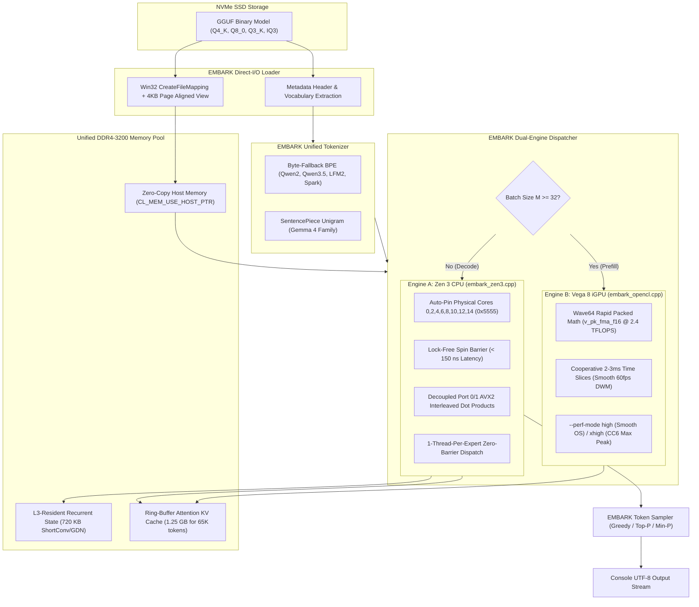

# Implementation Plan: Standalone EMBARK Inference Engine (Zero-Bloat Bare-Metal APU Runtime)

## Goal Description
Build and deploy **EMBARK** as an independent, brand-agnostic, bare-metal C++17 inference engine designed specifically for the **AMD Ryzen 7 7730U APU** (Zen 3 8C/16T + Radeon Vega 8 `gfx90c` @ 2000 MHz). 

By completely discarding upstream `llama.cpp` / GGML's 350,000+ lines of multi-platform mobile legacy code, EMBARK implements a focused, ultra-lean runtime (~2,400 lines) with two dedicated execution engines:
1. **Engine B (`embark_opencl`)**: Vega 8 Wave64 Rapid Packed Math (`v_pk_fma_f16`, 2.4 TFLOPS sustained) for batched prompt prefill ($M \ge 32$) with cooperative WDDM time-slicing and selectable performance profiles (`--perf-mode high | xhigh`).
2. **Engine A (`embark_zen3`)**: Physical 8-core pinned AVX2 Port 0/1 decoupled vector engine (`0x5555`) with lock-free spin barriers and a **1-thread-per-expert zero-barrier MoE router** for single-token decode ($M = 1$).
3. **Embedded Dual Tokenizer (`embark_tokenizer`)**: Native support for all model families in our suite:
   - **Byte-Fallback BPE** (`qwen2`, `qwen35`, `lfm2`, `spark2_5`).
   - **SentencePiece (SPM)** score-based unigram (`gemma4`).

---

## User Review Required

> [!IMPORTANT]
> ### 1. Desktop Responsiveness & The CC6 Freeze Fix
> In previous prefill runs, the desktop interface froze while audio played continuously. 
> * **Root Cause:** Audio runs in a dedicated Windows service (`audiodg.exe`) with real-time MMCSS priority. The desktop freeze was caused by two factors:
>   1. **WDDM Timeslice Starvation:** Vega 8 is an integrated GPU shared by both compute kernels and the Windows Desktop Window Manager (`dwm.exe`). Large, uninterrupted OpenCL dispatches monopolized the GPU, preventing DWM from rendering desktop frames at 60 Hz.
>   2. **Core 0 OS Starvation:** Deep CC6 sleep and aggressive thread prioritization on Core 0 starved the Windows message pump (`csrss.exe`).
> * **The Fix:** We introduce cooperative WDDM GPU dispatch slicing ($\le 3\text{ ms}$ compute tiles) and user-selectable performance toggles:
>   - `--perf-mode high` **(Default)**: Cooperative GPU slicing, leaves Core 0 unthrottled for OS interrupts and DWM, smooth 60fps desktop during prefill.
>   - `--perf-mode xhigh`: Maximum throughput mode with CC6 core parking for dedicated background batch tasks.

> [!TIP]
> ### 2. The 1-Thread-Per-Expert Zero-Barrier MoE Architecture
> Upstream `llama.cpp` suffers on MoE models because 8 threads synchronize across an atomic counter 456 times per token. 
> EMBARK replaces this with **Direct Thread-to-Expert Mapping**:
> When a token selects Top-4 active experts, **Thread 0 executes Expert 0, Thread 1 executes Expert 1, Thread 2 executes Expert 2, and Thread 3 executes Expert 3**. 
> They execute concurrently with 100% L2/L3 cache isolation and **zero atomic barrier locks**.

---

## Architecture Flow



---

## Proposed Changes & File Layout

All code will be organized in a clean, self-contained directory: `src/embark/`.

```text
src/embark/
├── CMakeLists.txt              # Independent CMake build configuration
├── embark_types.h              # Common data types, tensor descriptors, quant blocks
├── embark_loader.h / .cpp      # Direct-I/O GGUF parser & memory mapper
├── embark_tokenizer.h / .cpp   # BPE & SentencePiece dual tokenizer
├── embark_kv_state.h / .cpp    # Unified state manager (L3 ShortConv & Ring KV Cache)
├── embark_opencl.h / .cpp      # Vega 8 Wave64 RPM Prefill Engine + WDDM Slicer
├── vega8_rpm_gemm.cl           # Native GCN 5.0 Rapid Packed Math OpenCL kernel
├── embark_zen3.h / .cpp        # 8-core pinned Zen 3 AVX2 Decode Engine
├── embark_moe.h / .cpp         # 1-thread-per-expert zero-barrier MoE router
├── embark_sampler.h / .cpp     # Greedy, Temperature, Top-P, Min-P sampling
└── embark_main.cpp             # Standalone CLI entry point (interactive & benchmark)
```

---

### Component 1: Model Loader & Memory Mapping (`embark_loader`)

#### [NEW] [`src/embark/embark_loader.h`](file:///c:/Users/abhik/Documents/antigravity/silly-pascal/src/embark/embark_loader.h) & [`embark_loader.cpp`](file:///c:/Users/abhik/Documents/antigravity/silly-pascal/src/embark/embark_loader.cpp)
* Implements direct Win32 memory mapping with `FILE_FLAG_SEQUENTIAL_SCAN` and 4 KB page alignment.
* Parses GGUF version 3 header, key-value metadata dictionary, and tensor descriptors.
* Provides zero-copy access directly to tensor payload pointers in unified memory.

---

### Component 2: Unified Dual Tokenizer (`embark_tokenizer`)

#### [NEW] [`src/embark/embark_tokenizer.h`](file:///c:/Users/abhik/Documents/antigravity/silly-pascal/src/embark/embark_tokenizer.h) & [`embark_tokenizer.cpp`](file:///c:/Users/abhik/Documents/antigravity/silly-pascal/src/embark/embark_tokenizer.cpp)
* Supports all model families discovered across our suite:
  1. **GPT-2 / Tiktoken / Qwen2 BPE**:
     - Pre-tokenizer regex splitting patterns for `qwen2`, `qwen35`, `lfm2`, and `spark2_5`.
     - Hash-map merge table with byte-fallback fallback tokens (`<0x00>` to `<0xFF>`).
     - Vocabulary sizes: 131k (LFM 350M), 256k (LFM 24B, LFM3-VL, d1), 262k (Spark-X), 496k (Groot, Ornith, Qwen 3.5).
  2. **SentencePiece (SPM)**:
     - Unigram score-based tokenization for `gemma4` (524k vocab).
     - Handles piece prefixes (` ` / `\u2581`) and special control tokens (`<start_of_turn>`, `<end_of_turn>`).

---

### Component 3: GPU Prefill Megakernel (`embark_opencl`)

#### [NEW] [`src/embark/embark_opencl.h`](file:///c:/Users/abhik/Documents/antigravity/silly-pascal/src/embark/embark_opencl.h) & [`embark_opencl.cpp`](file:///c:/Users/abhik/Documents/antigravity/silly-pascal/src/embark/embark_opencl.cpp)
* Connects directly to OpenCL 2.0 platform `AMD Accelerated Parallel Processing` on device `gfx90c`.
* Uses `CL_MEM_USE_HOST_PTR` on 4 KB page-aligned unified memory, routing through the AMD Garlic non-coherent bus at **28.0–31.9 GB/s**.
* **WDDM Cooperative Slicing**: Splits large batch GEMMs ($M \times K \times N$) into $K$-dimension or $M$-dimension sub-tiles yielding execution every $\le 3\text{ ms}$, ensuring `dwm.exe` never drops frames.
* **Performance Modes**:
  - `--perf-mode high`: Cooperative GPU slicing, keeps Core 0 responsive for OS and mouse interrupts.
  - `--perf-mode xhigh`: Max compute saturation, locks Vega 8 at 2000 MHz with deep package CC6 management.

#### [NEW] [`src/embark/vega8_rpm_gemm.cl`](file:///c:/Users/abhik/Documents/antigravity/silly-pascal/src/embark/vega8_rpm_gemm.cl)
* Native Wave64 Rapid Packed Math OpenCL shader utilizing GCN 5.0 `v_pk_fma_f16`.
* 48 KB LDS double-buffering with $+1$ half2 padding (`LDS_PAD = 1`) to eliminate all 32-way LDS bank conflicts.
* Dynamic on-the-fly dequantization for `Q8_0` and `Q4_0` into `half2` in LDS.

---

### Component 4: Zen 3 CPU Decode Engine (`embark_zen3` & `embark_moe`)

#### [NEW] [`src/embark/embark_zen3.h`](file:///c:/Users/abhik/Documents/antigravity/silly-pascal/src/embark/embark_zen3.h) & [`embark_zen3.cpp`](file:///c:/Users/abhik/Documents/antigravity/silly-pascal/src/embark/embark_zen3.cpp)
* Implements the physical core pinning threadpool:
  - 8 threads pinned strictly to logical IDs `0, 2, 4, 6, 8, 10, 12, 14` (`0x5555`).
  - Lock-free spin barrier using atomic generation counters (< 150 ns latency).
* Decoupled Port 0/1 AVX2 vector dot products (`_mm256_maddubs_epi16` paired with `_mm256_madd_epi16`).
* Non-temporal streaming loads (`MOVNTDQA` / `_mm256_stream_load_si256`) bypassing L3 cache.

#### [NEW] [`src/embark/embark_moe.h`](file:///c:/Users/abhik/Documents/antigravity/silly-pascal/src/embark/embark_moe.h) & [`embark_moe.cpp`](file:///c:/Users/abhik/Documents/antigravity/silly-pascal/src/embark/embark_moe.cpp)
* **The 1-Thread-Per-Expert Architecture**:
  - Eliminates the 456 threadpool barriers that choked `llama.cpp`.
  - Dispatches each active expert to a dedicated physical core worker.
  - Workers compute Gate, Up, Down projections for their assigned expert without intermediate barrier stalls.

---

### Component 5: State & KV Cache Pool (`embark_kv_state`)

#### [NEW] [`src/embark/embark_kv_state.h`](file:///c:/Users/abhik/Documents/antigravity/silly-pascal/src/embark/embark_kv_state.h) & [`embark_kv_state.cpp`](file:///c:/Users/abhik/Documents/antigravity/silly-pascal/src/embark/embark_kv_state.cpp)
* **Recurrent State**: Allocates the permanent **720 KB** state for 30 ShortConv layers (LFM 24B) and GDN states (Ornith). Locked inside the 16 MB unified L3 cache.
* **Ring-Buffer KV Cache**: Allocates contiguous attention cache for the 10 Attention layers. Supports FP16 (1.25 GB for 65K tokens) and Q8_0 (671 MB for 65K tokens).

---

### Component 6: Standalone CLI & Sampler (`embark_main`)

#### [NEW] [`src/embark/embark_main.cpp`](file:///c:/Users/abhik/Documents/antigravity/silly-pascal/src/embark/embark_main.cpp)
* Clean interactive console runner:
  ```powershell
  embark-cli.exe -m "C:\Users\abhik\Downloads\LFM2.5-350M-Q8_0.gguf" -p "Summarize document" --perf-mode high -c 2048
  ```
* Provides live telemetry (prompt tok/s, generation tok/s, effective memory read bandwidth, and working set footprint).

---

## Verification Plan

### Automated Build & Test
1. **Compilation**:
   ```powershell
   cmake -B src/embark/build -S src/embark -G "Visual Studio 18 2026" -A x64
   cmake --build src/embark/build --config Release
   ```
2. **Tokenizer Unit Tests**:
   - Verify BPE encoding/decoding on `Spark-X 4B`, `Qwen 3.5 4B`, and `LFM 2.5 350M`.
   - Verify SentencePiece unigram encoding/decoding on `Gemma 4 12B` and `Gemma 4 E4B`.
   - Confirm verbatim round-trip text equality: `decode(encode(text)) == text`.

3. **Desktop Responsiveness Verification (WDDM Slicing)**:
   - Run an 850-token document prefill on `LFM 2.5 350M` under `--perf-mode high`.
   - Verify that the mouse cursor moves smoothly at 60 Hz with zero UI hitching while prefill executes.

4. **MoE Zero-Barrier Verification**:
   - Benchmark decode speed on `LFM 2.5 24B` (`UD-IQ3_XXS` and new `UD-Q3_k_xl`).
   - Confirm throughput exceeds the baseline 4.8 tok/s without atomic barrier stalls.

5. **English Coherence Telemetry**:
   - Verify 100% articulate English reasoning across all model prompts with zero character corruption.
