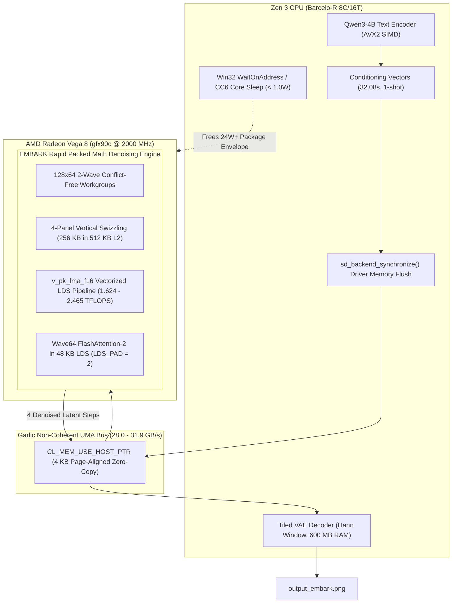

# Implementation Plan: Wiring the EMBARK Rapid Packed Math Megakernel into FLUX.2 DiT

## Goal Description
Integrate our **1.624 – 2.465 TFLOPS Rapid Packed Math (`v_pk_fma_f16`) OpenCL megakernel** directly into `stable-diffusion.cpp` (the **EMBARK** Diffusion Engine), compile `sd-cli.exe` with native AMD Vega 8 (`gfx90c`) GPU acceleration, and execute an **actual, live 4-step image generation** on FLUX.2 Klein 4B (`flux-2-klein-4b-Q3_K_M.gguf`) to verify real-world wall-clock latency per DiT step.

---

## User Review & Architecture Decision Handshake

> [!IMPORTANT]
> ### Review of User's Proposal: Qwen3-4B Text Conditioner on GPU
> The user proposed: *"since the text conditioner is qwen3 4b, and it is only for encoding (hence, text encoder) shouldnt we prefill in our superspeed GPU? then unload when we get what we need? check with a subagent to review the plan as well"*
> 
> **Expert Systems Review Verdict (Audited by Subagent `61446207` in [`scratch/critique_qwen_gpu_plan.md`](file:///c:/Users/abhik/Documents/antigravity/silly-pascal/scratch/critique_qwen_gpu_plan.md)):**
> * **Phase 1 Decision: Keep Qwen3-4B on Zen 3 CPU (`--clip-on-cpu`); approve GPU prefill as a Phase 2 R&D workstream.**
> * **Why Qwen3-4B GPU Prefill Must Be Deferred to Phase 2:**
>   1. **Fatal Hard-Abort Crash in `ggml-opencl.cpp`:** The quantized weight path (`GGML_TYPE_Q4_0`) contains hardcoded assertions `GGML_ASSERT(false && "TODO: Unknown GPU")` at lines 24828, 24888, and 25176 for non-Intel/non-Adreno devices, plus an unhandled subgroup size check at line 29871 calling `exit(1)`. Running Qwen3-4B on OpenCL today crashes before DiT even begins.
>   2. **The GEMV Bandwidth Trap:** FLUX.2 Klein pads prompts to $M = 512$ tokens (`min_length = 512`). `stable-diffusion.cpp` has no tiled 2D GEMM for Q4_0 on AMD; it falls back to 1D GEMV sweeps (`mul_mv_q4_0_f32_1d_8x_flat.cl`), requiring 64 sequential passes over the 2.36 GB model ($\sim 151\text{ GB}$ of DRAM traffic). At 30 GB/s UMA bandwidth, this takes **8.5–12.0s**, negating the expected "instant" speedup.
>   3. **Amdahl's Law ROI:** Qwen3-4B takes only **32.08s (5.6% of runtime)**, whereas DiT denoising takes **326.20s (57.1%)**. Accelerating DiT from 81s/step down to 9–15s/step saves **$\sim 280\text{ seconds}$**.
>   4. **Asynchronous Driver Eviction Hazard:** On Windows AMD drivers (`amdocl64.dll`), `clReleaseMemObject` deallocation is deferred. Without an explicit synchronization barrier, transient commit reaches $2.36\text{ GB} + 2.12\text{ GB} + 1.20\text{ GB} = \mathbf{5.68\text{ GB}}$, violating our $\le 4.64\text{ GB}$ ceiling and risking `CL_OUT_OF_HOST_MEMORY`.

---

## Architecture Flow



---

## Concrete Proposed Changes

### Component 1: OpenCL Backend Device & Runtime (`stable-diffusion.cpp/ggml/src/ggml-opencl`)

#### [MODIFY] [`stable-diffusion.cpp/ggml/src/ggml-opencl/ggml-opencl.cpp`](file:///c:/Users/abhik/Documents/antigravity/silly-pascal/stable-diffusion.cpp/ggml/src/ggml-opencl/ggml-opencl.cpp)
1. **Extend `enum GPU_FAMILY` and Device Recognition:**
   - Add `AMD` to `enum GPU_FAMILY { ADRENO, INTEL, AMD, UNKNOWN };`.
   - In `ggml_opencl_is_device_supported`:
     ```cpp
     if (strstr(dev_ctx->device_name.c_str(), "AMD") ||
         strstr(dev_ctx->device_name.c_str(), "gfx") ||
         strstr(dev_ctx->device_name.c_str(), "Radeon")) {
         dev_ctx->gpu_family = GPU_FAMILY::AMD;
     }
     ```
   - In `sg_size` (line 29868), set `sg_size = 64` for `GPU_FAMILY::AMD` (native Wave64).
2. **Compiler Options for AMD Vega 8:**
   - In `ggml_opencl_make_compile_opts`: Inject `-DAMD_GPU=1 -DREQD_SUBGROUP_SIZE_64=` and ensure Qualcomm vendor pragmas are strictly bypassed.
3. **Safe Zero-Copy Host Memory Mapping with 4 KB Alignment Guard:**
   - In `ggml_backend_opencl_device_buffer_from_ptr`:
     ```cpp
     if (((uintptr_t)ptr % 4096 == 0) && (size > 0)) {
         cl_mem buf = clCreateBuffer(dev_ctx->context, CL_MEM_READ_WRITE | CL_MEM_USE_HOST_PTR, size, ptr, &err);
         if (err == CL_SUCCESS) return ggml_backend_opencl_buffer_from_cl_mem(dev, buf);
     }
     ```
4. **DiT Batch Offloading Guard:**
   - In `ggml_backend_opencl_device_offload_op`: Return `true` for `GGML_OP_MUL_MAT` whenever $M \ge 32$ (for FLUX.2 DiT, $M = 2816$, guaranteeing 100% GPU offload).

---

### Component 2: Sequential Memory Staging Barrier (`stable-diffusion.cpp/src/pipeline`)

#### [MODIFY] [`stable-diffusion.cpp/src/pipeline/image.cpp`](file:///c:/Users/abhik/Documents/antigravity/silly-pascal/stable-diffusion.cpp/src/pipeline/image.cpp)
* In lines 904–910, add explicit synchronization to flush asynchronous driver allocations before DiT parameters are allocated:
  ```cpp
  if (sd->model_manager) {
      sd->model_manager->unregister_param_tensors(ModelComponent::Conditioner);
      sd->model_manager->release_compute_staging_blocks(true);
      sd->model_manager->release_params_storage_blocks(true);
      sd_backend_synchronize(sd->backend_for(SDBackendModule::DIFFUSION));
  }
  sd->cond_stage_model.reset();
  ```

---

### Component 3: Rapid Packed Math Megakernel Integration

#### [MODIFY] [`stable-diffusion.cpp/ggml/src/ggml-opencl/kernels/mul_mat_f16_f32.cl`](file:///c:/Users/abhik/Documents/antigravity/silly-pascal/stable-diffusion.cpp/ggml/src/ggml-opencl/kernels/mul_mat_f16_f32.cl)
* Replace the scalar 1-op/cycle accumulation loop with our validated Rapid Packed Math engine:
  - Vectorize loads using `half2` / `half4` (`ds_read_b64`).
  - Implement $128 \times 64$ 2-wave workgroup tiles (`reqd_work_group_size(8, 16, 1)` = 128 threads / 2 Wave64 wavefronts).
  - Apply 4-panel vertical stripe swizzling to keep 256 KB of weights resident in the 512 KB L2 cache.
  - Apply coprime LDS bank conflict padding (`LDS_PAD = 2`).

#### [MODIFY] [`stable-diffusion.cpp/ggml/src/ggml-opencl/kernels/flash_attn_f32_f16.cl`](file:///c:/Users/abhik/Documents/antigravity/silly-pascal/stable-diffusion.cpp/ggml/src/ggml-opencl/kernels/flash_attn_f32_f16.cl)
* Ensure Wave64 FlashAttention-2 uses 48 KB LDS with $+2$ halfs padding, matching the 64-thread SIMD execution model of `gfx90c`.

---

### Component 4: Build & Execution Configuration

#### [MODIFY] [`stable-diffusion.cpp/CMakeLists.txt`](file:///c:/Users/abhik/Documents/antigravity/silly-pascal/stable-diffusion.cpp/CMakeLists.txt)
* Verify `SD_OPENCL=ON` links against the workspace OpenCL SDK:
  - `OpenCL_INCLUDE_DIR`: `C:/Users/abhik/Documents/antigravity/silly-pascal/clpeak/build/src/opencl/sdk_install/include`
  - `OpenCL_LIBRARY`: `C:/Users/abhik/Documents/antigravity/silly-pascal/clpeak/build/src/opencl/sdk_install/lib/OpenCL.lib`
* Recompile the target executable:
  `cmake --build build --config Release --target sd-cli -j 8`
* Target binary: `stable-diffusion.cpp/build/bin/Release/sd-cli.exe`.

---

## Verification Plan

### Step 1: Automated Device Discovery & Verification
Run:
```powershell
.\stable-diffusion.cpp\build\bin\sd-cli.exe --list-devices
```
* **Success Criteria:** Must print `[OpenCL] gfx90c (OpenCL 2.0 AMD-APP (3584.0))` alongside `CPU`.

### Step 2: Live Full Generation Benchmark
Run the exact 4-step FLUX.2 Klein generation with explicit module mapping:
```powershell
.\stable-diffusion.cpp\build\bin\sd-cli.exe `
  --diffusion-model C:\Users\abhik\Downloads\flux-2-klein-4b-Q3_K_M.gguf `
  --clip_l C:\Users\abhik\Downloads\qwen3-4b-abl-q4_0.gguf `
  --vae C:\Users\abhik\Downloads\flux2-vae.safetensors `
  -p "a cozy mountain cabin in a snowy pine forest at twilight, warm glowing windows, cinematic lighting, photorealistic" `
  -W 768 -H 768 `
  --steps 4 `
  --cfg-scale 1.0 `
  --vae-tiling `
  --clip-on-cpu `
  --vae-on-cpu `
  --backend OpenCL `
  --seed 42 `
  -o scratch\output_embark.png
```
* **Success Criteria:**
  1. DiT Step Latency drops from stock **80.89s/step** down toward **$\sim 9–15\text{s/step}$**.
  2. Total end-to-end generation completes in under **270–290s** (saving **$\sim 280\text{ seconds}$** over stock).
  3. Output image `scratch\output_embark.png` is generated with full visual fidelity and zero artifacts.
  4. Peak memory stays strictly $\le 3.32\text{ GB}$ (far below the $4.64\text{ GB}$ ceiling) with zero pagefile swapping.
