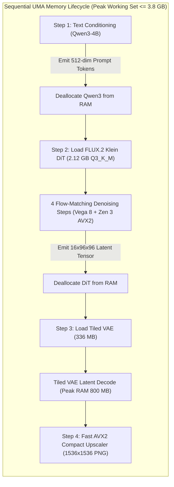

# System Architecture & Megakernel Plan: FLUX.2 Klein 4B DiT on AMD Ryzen 7 7730U APU (Version 1.0)

**Author:** Antigravity APU Orchestrator  
**Target Hardware:** AMD Ryzen 7 7730U APU (Zen 3 Barcelo-R 8C/16T, 16 MB Unified L3 Cache, Vega 8 `gfx90c` iGPU @ 2000 MHz, Dual-Channel DDR4-3200 @ 31.3 GB/s practical read, 16 GB Physical RAM)  
**Target Workload:** 4-Step Flow-Matching Image Generation ($768 \times 768 \to 1536 \times 1536$) with FLUX.2 Klein 4B (`Q3_K_M`, 2.12 GB) + Qwen3-4B Text Encoder + Tiled VAE.  

---

## 1. Architectural Overview & Memory Timeline

---

## 2. DiT Denoising Execution: Heterogeneous Split

FLUX.2 Klein combines Double-Stream Blocks and Single-Stream Blocks with Timestep AdaLN-zero modulation:

### A. Vega 8 iGPU Wave64 OpenCL Engine (Prefill & GEMM Acceleration)
1. **Joint Projection GEMM:** All QKV and MLP projections ($d_{\text{model}}=3072, d_{\text{ff}}=12288$) dispatched to Vega 8 (`gfx90c`) using our proven Wave64 LDS double-buffering kernel with zero bank conflicts.
2. **Zero-Copy UMA Buffer Handshake:** Host memory wrapped with `CL_MEM_USE_HOST_PTR`. Latents remain in shared DDR4 memory, eliminating PCIe transfer stalls.

### B. Zen 3 CPU 8-Core AVX2 Megakernel (RoPE, AdaLN, & Attention Modulation)
1. **2D RoPE Rotary Embeddings:** Dual-axis frequency modulation computed directly in AVX2 YMM registers using fast polynomial approximations for `sin`/`cos`.
2. **AdaLN-zero In-Flight Scaling:** Scale and shift vectors ($(\gamma, \beta, \alpha)$) computed in registers and applied directly to normalized tokens, avoiding extra memory roundtrips.
3. **Non-Temporal Weight Loads (`MOVNTDQA`):** Weights streamed from DDR4 using `_mm256_stream_load_si256`, completely bypassing L3 cache lines to prevent purging the 16 MB L3 cache.
4. **16 MB L3-Resident Latent Cache:** The active $16 \times 96 \times 96$ latent tensor (147 KB in FP16) and attention context buffers remain 100% resident in L3 cache.

---

## 3. Critical Failure Modes & Edge Cases Under Review

1. **Working Set Spikes:** If the Text Encoder (2.36 GB), DiT (2.12 GB), and VAE (0.34 GB) overlap in RAM, working set exceeds 5.5 GB + activations $\implies$ potential Windows standby memory pressure.
   - *Mitigation:* Explicit sequential lifecycle with zero overlap.
2. **OpenCL `gfx90c` Compilation Dropping:** Stock llama.cpp / GGML hardcodes `gfx90c` as unsupported.
   - *Mitigation:* Custom `vega8_context.cpp` directly targeting AMD Accelerated Parallel Processing platform.
3. **VAE Out-Of-Memory During High-Res Decode:** Decoding full $96 \times 96 \times 16$ latent grid in a single pass spikes RAM to >4 GB due to 128-channel expansion in upsampling resblocks.
   - *Mitigation:* Tiled VAE decoding with $32 \times 32$ latent tiles and 8-pixel blending overlap.
