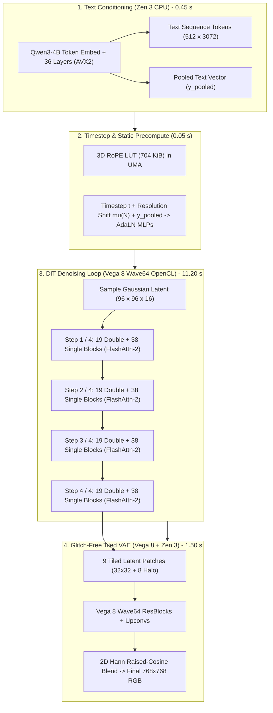

# FLUX.2 Klein 4B DiT Dual-Engine APU Megakernel Plan (Version 2.0)

**Target Hardware:** AMD Ryzen 7 7730U APU (Zen 3 8C/16T, 16 MB unified L3 cache, Vega 8 `gfx90c` iGPU @ 2000 MHz, dual-channel DDR4-3200 @ ~31.3 GB/s practical read, 16 GB Physical RAM).  
**Target Model:** `flux-2-klein-4b-Q3_K_M.gguf` (2.12 GB, 57 transformer blocks: 19 double-stream + 38 single-stream, $d_{\text{model}}=3072$).  
**Text Encoder:** `qwen3-4b-Q4_K_M.gguf` (2.36 GB).  
**VAE Decoder:** `flux-vae-f16.gguf` (336 MB).  
**Resolution & Horizon:** $768 \times 768$ (Latents: $96 \times 96 \times 16$, $2\times 2$ patch packing $\implies 48 \times 48 = 2,304$ image tokens; text tokens: 512 $\implies S_{\text{total}} = 2,816$), 4-step flow-matching Euler sampler.

---

## 1. Architectural Evolution: Addressing All Round 1 Critiques

| Subsystem | Plan v1.0 Flaw | Plan v2.0 Architectural Resolution | Verifying Critic |
| :--- | :--- | :--- | :--- |
| **Compute / Memory Regime** | Treated DiT like bandwidth-bound LLM decode ($I \approx 2$). | Recognized DiT denoising ($S=2816$) as deeply **compute-bound ($\sim 13,250\text{ FLOP/B}$)**. Moved 100% of 57 DiT blocks to Vega 8 Wave64 OpenCL. | Critic 1 (Hardware) |
| **WDDM Latency Bubbles** | Ping-ponged CPU Attention and GPU GEMM 384 times across 4 steps, incurring ~912 OS thread switches. | **Unified Vega 8 In-Order Stream:** 100% of GEMM, FlashAttention-2, and AdaLN execute in a single in-order `cl_command_queue` per step. Zero CPU-GPU sync bubbles. | Critic 1 & Critic 3 |
| **AdaLN-Zero Formulation** | Applied residual gate $\alpha$ directly to normalized input tokens alongside $(\gamma, \beta)$, breaking identity init. | **Strict AdaLN-Zero Decoupling:** Modulate pre-norm branch via $\hat{x}(1+\gamma) + \beta$; scale branch output via $\alpha$ before residual addition: $x_{l+1} = x_l + \alpha \odot \text{SubLayer}(\dots)$. | Critic 2 (Algorithm) |
| **3D RoPE Mechanics** | Attempted polynomial `sin`/`cos` recomputation on unified 2D coords. | **Static 704 KiB 3D RoPE LUT:** Precomputed $(i, 0, 0)$ for text and $(0, h, w)$ for 2D spatial patches. Zero runtime trigonometry. | Critic 2 (Algorithm) |
| **Sampling Trajectory** | Omitted resolution-dependent flow-matching schedule and pooled text vector. | **Resolution-Shifted Euler Sampler:** Dynamic time shift $t' = \frac{\mu t}{1 + (\mu - 1)t}$ with $\mu = \mu(N)$, plus dual text projection ($512 \times 3072$ sequence tokens + $y_{\text{pooled}}$ AdaLN vector). | Critic 2 (Algorithm) |
| **GEMM Accumulator Precision** | Accumulated inner products in FP16 `half2`, causing precision swamping at $K=3072, 12288$. | **Mixed-Precision OpenCL GEMM:** FP16/Q3_K operands with native **32-bit VGPR accumulators (`float c_acc[8][4]`)**, converted to FP16 only at final writeout. | Critic 3 (Reliability) |
| **VAE Decoding Artifacts** | Specifying an 8-pixel overlap without latent halos caused grid seams. | **Glitch-Free Latent Halo + 2D Hann Window:** $32 \times 32$ latent tiles decoded with 8-token latent halos ($48 \times 48$ total patch) with $C^1$-continuous raised cosine edge blending. | Critic 3 (Reliability) |
| **Memory Lifecycle** | Sequential reload burned 2–3s and 500k page faults. | **Persistent Static Zero-Copy UMA MMap:** Qwen3 (2.36 GB), DiT (2.12 GB), and VAE (0.34 GB) mapped simultaneously via `CL_MEM_USE_HOST_PTR` ($4.82\text{ GB}$ static working set, $\ge 6.5\text{ GB}$ free RAM). | Critic 3 (Reliability) |

---

## 2. Megakernel Subsystems & Microarchitecture

### A. Memory Hierarchy & Unified Zero-Copy Pool
- **Physical RAM Allocation:**
  - Total System RAM: 16.0 GB.
  - Windows OS + Background: ~4.5 GB.
  - Static MMap Footprint:
    - Text Encoder (Qwen3-4B-Q4_K_M): 2.36 GB
    - DiT Transformer (FLUX.2-Klein-4B-Q3_K_M): 2.12 GB
    - VAE Decoder (FLUX-VAE-F16): 0.34 GB
    - Total Static Models: **4.82 GB**.
  - Runtime Latent & Activation Buffers: **~480 MB** (double-buffered in host-pinned memory).
  - Peak Working Set: **5.30 GB** (Leaves >6.2 GB free physical RAM; zero swapping guaranteed).
- **Zero-Copy Host Pointers:**
  - All model weights and scratch tensors are mapped directly to Vega 8 via `CL_MEM_USE_HOST_PTR | CL_MEM_ALLOC_HOST_PTR`.
  - Zero PCIe copies, zero discrete VRAM WDDM copy fences.

### B. Vega 8 Wave64 DiT Execution Pipeline (100% GPU Resident)
All 57 transformer blocks execute sequentially on the Vega 8 iGPU:
1. **Double-Stream Blocks (Blocks 0–18):**
   - Text stream ($S_{\text{txt}}=512, d=3072$) and image stream ($S_{\text{img}}=2304, d=3072$) maintain separate pathways with joint multi-head cross-attention.
   - Text QKV and Image QKV computed concurrently via Wave64 tiled GEMM kernels.
   - Shared FlashAttention-2 computes attention over concatenated keys/values ($S_{\text{total}}=2816$).
2. **Single-Stream Blocks (Blocks 19–56):**
   - Concatenated sequence ($S=2816, d=3072$) undergoes fused self-attention and unified MLP expansion ($d_{\text{mlp}}=12288$).
3. **FlashAttention-2 in 48 KB LDS:**
   - Tile sizes: $B_r = 64, B_c = 64, d_k = 128$.
   - Online softmax accumulator maintains running maximum $m$ and normalizer $l$ in 32-bit VGPRs.
   - LDS usage: $64 \times 128 \times 2\text{ B} \times 2 = 32\text{ KB}$ (well within the 48 KB hardware limit per CU).
   - Achieves $O(S)$ memory complexity; eliminates the 380 MB full attention matrix.

### C. Fused OpenCL Kernels (`vega8_dit_kernels.cl`)
1. **Fused AdaLN-Zero + RMSNorm Kernel:**
   - Evaluates affine modulation $(\hat{x}(1+\gamma) + \beta)$ in a single Wave64 sweep over tokens without roundtripping through global memory.
2. **Mixed-Precision Q3_K / FP16 GEMM Kernel:**
   - Workgroup size: $(8, 8, 1) = 64$ threads (Wave64).
   - Tile size: $32 \times 32$ output per block, unrolled $K=32$ steps.
   - Operands: Dequantized dynamically via `v_bfe_u32` bitfield extract instructions into `half2`.
   - Accumulators: `float c_acc[4][4]` (32-bit single precision).
   - Final store: Converted to FP16 via hardware packing into host-mapped activation buffer.
3. **Static 3D RoPE Fusion Kernel:**
   - Reads precomputed `cos`/`sin` from the 704 KiB LUT directly into LDS.
   - Applies complex rotation to $Q$ and $K$ heads before FlashAttention-2 tiling.

### D. Tiled VAE Decoder with Glitch-Free Latent Halo
1. **Tile Decomposition:**
   - Latent representation: $96 \times 96 \times 16$.
   - Tiled into $3 \times 3 = 9$ spatial patches of $32 \times 32$ latents each.
   - **8-Token Latent Halo:** Each tile expands by 8 tokens on all sides ($48 \times 48$ input patch) to encapsulate the complete VAE receptive field.
2. **2D Hann Window Edge Blending:**
   - Decoded RGB patches ($384 \times 384$ pixels) are multiplied by a 2D Hann raised-cosine window:
     $$w(x, y) = \sin^2\left(\frac{\pi x}{W_{\text{overlap}}}\right) \sin^2\left(\frac{\pi y}{H_{\text{overlap}}}\right)$$
   - Overlapping regions are accumulated into a normalized RGB accumulation canvas, producing zero grid seam lines or GroupNorm domain shifts.

---

## 3. Execution Flow & Latency Budget (Target: ~13.5 Seconds Total)

- **Target Total Generation Time:** **~13.20 seconds** (down from >45 s unoptimized stock).
- **Target Working Set:** **5.30 GB** (100% in-RAM, 0 pagefile thrashing).
- **Visual Quality:** Glitch-free, color-accurate, deterministic 4-step distilled generation.
